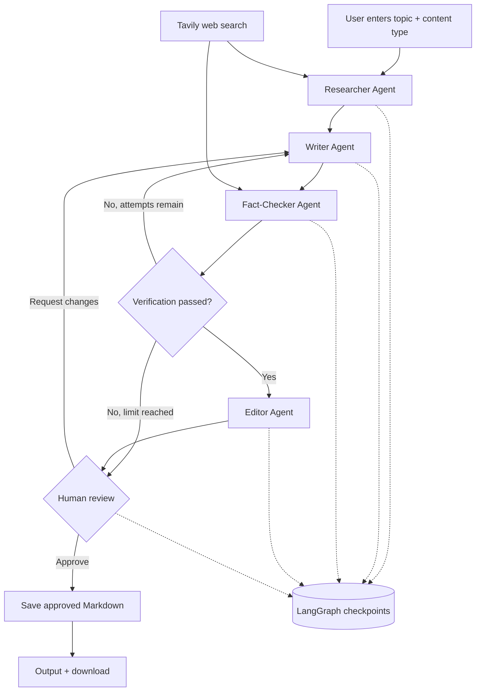

# Multi-Agent Content Studio

**An AI-assisted research, writing, fact-checking, and editing pipeline with human approval.**

Multi-Agent Content Studio coordinates four specialized AI agents to turn a topic into a research-backed blog post or newsletter. **LangGraph** manages the workflow, **Google Gemini** generates and reviews text, **Tavily** retrieves web research, and **Streamlit** provides an interactive dashboard. The workflow pauses before saving an approved article so a person can review sources, request revisions, or approve the result.

> **Project status:** Local-development prototype. It includes automated checks, but a `PASS` verdict does **not** guarantee that every claim is accurate. Review sources before approving or publishing.

## Contents

- [Features](#features)
- [System architecture](#system-architecture)
- [How the agents collaborate](#how-the-agents-collaborate)
- [Project structure](#project-structure)
- [Prerequisites](#prerequisites)
- [Installation and configuration](#installation-and-configuration)
- [How to use the web dashboard](#how-to-use-the-web-dashboard)
- [How to use the terminal interface](#how-to-use-the-terminal-interface)
- [Data storage and recovery](#data-storage-and-recovery)
- [Troubleshooting](#troubleshooting)
- [Security and limitations](#security-and-limitations)
- [Future improvements](#future-improvements)

## Features

- **Four specialized agents:** Researcher, Writer, Fact-Checker, and Editor.
- **Web research:** Tavily retrieves source material, which Gemini summarizes.
- **Conditional revision loop:** Failed fact-checks send the draft back to the Writer (up to the configured attempt limit).
- **Human-in-the-loop approval:** Read the article and verification report, approve it, or request changes.
- **Two content formats:** Blog posts and newsletters.
- **Interactive Streamlit UI:** Create content, see agent progress, review drafts, and download Markdown.
- **Article library:** Search past articles and filter by generation status.
- **SQLite persistence:** Store LangGraph checkpoints and a separate article index locally.
- **Markdown export:** Save approved content to `output/`.

## System architecture



**Technology responsibilities**

| Technology | Role |
|---|---|
| Python | Application language |
| LangGraph | Agent orchestration, state transitions, review interrupts |
| Google Gemini (`google-genai`) | Research synthesis, drafting, verification reasoning, editing |
| Tavily | External web-search results for research and verification |
| Streamlit | Web interface and human approval controls |
| SQLite | Local checkpoint storage and article metadata |
| `python-dotenv` | Local environment-variable loading |

## How the agents collaborate

The agents are distinct **LangGraph nodes**, not separate background servers. Each reads and updates a shared workflow state containing items such as `topic`, `research`, `draft`, `fact_check`, `verified`, `revisions`, `final_article`, `approved`, and `output_path`.

### 1. Researcher Agent

**Input:** Topic and content type.

1. Sends the topic to Tavily to find relevant web results.
2. Passes retrieved information to Gemini for structured research notes.
3. Returns research findings and available source references to the shared state.

**Output:** `research`.

### 2. Writer Agent

**Input:** Topic, research notes, previous draft (if any), and revision feedback.

1. Writes a structured blog or newsletter draft in Markdown.
2. Uses the collected research as its source material.
3. On revision, responds to fact-check feedback or the human's comments.

**Output:** `draft`.

### 3. Fact-Checker Agent

**Input:** Draft and research notes.

1. Searches for additional evidence using Tavily.
2. Uses Gemini to assess important factual statements, dates, figures, and citations.
3. Returns a report starting with `VERDICT: PASS` or `VERDICT: FAIL`.
4. LangGraph routes a failing draft back to the Writer until the configured verification-attempt limit is reached.

**Output:** `fact_check`, `verified`, and updated `revisions`.

> The current verifier uses an overall model-generated verdict; it is **not** an independent proof of every claim. Claims may still be wrong or missing adequate evidence.

### 4. Editor Agent

**Input:** Draft and fact-check report.

1. Improves clarity, grammar, headings, tone, and flow.
2. Is instructed to preserve facts and citations rather than introduce new claims.
3. Produces the publication-ready Markdown draft for review.

**Output:** `final_article`.

### 5. Human approval and revision

At the review stage, LangGraph calls `interrupt()` and **pauses**. The dashboard shows the article, research notes, and verification report.

- **Approve Article:** Resume with `Command(resume={"approved": True, "feedback": ""})`; the workflow saves the article to `output/`.
- **Request Changes:** Resume with `Command(resume={"approved": False, "feedback": "..."})`; the Writer produces a new draft and the review cycle repeats.
- **Verification-attempt limit reached:** The workflow still moves to human review, with the failed verification report visible. **Approval is a human decision**, so verify any unsupported claims manually.

A revision after human rejection re-runs the Writer and Fact-Checker, and the Editor runs if verification passes. The default implementation limits automatic fact-check revisions per workflow state; it does not guarantee that unlimited human-requested revision cycles will be safe or inexpensive.

## Project structure

```text
multi-agent-content-pipeline/
├── app.py                   # Streamlit dashboard and review controls
├── main.py                  # Command-line interface
├── pipeline.py              # Agents, shared state, and LangGraph workflow
├── database.py              # Article metadata and history queries
├── test_gemini.py           # Optional Gemini connectivity test
├── requirements.txt         # Python dependencies
├── .env.example             # Safe environment variable template
├── .gitignore               # Excludes secrets and local data
├── .env                     # Your actual API keys (not committed)
├── checkpoints.sqlite       # Generated locally: LangGraph state
├── articles.sqlite          # Generated locally: article index
└── output/                  # Generated locally: approved Markdown
```

The SQLite files and `output/` are created as the application runs; they do not need to exist in a fresh clone.

## Prerequisites

- Python **3.11+** (Python 3.12 works for the demonstrated local setup).
- Git, optionally VS Code.
- A **Gemini API key** from [Google AI Studio](https://aistudio.google.com/apikey).
- A **Tavily API key** from [Tavily](https://tavily.com/).
- Internet access and available API quota for the chosen Gemini model and Tavily search.

**API quotas and model availability change.** Use a model identifier currently supported by your Gemini account. A model that once worked may be renamed, unavailable, rate-limited, or subject to billing.

## Installation and configuration

### 1. Clone your repository

```bash
git clone https://github.com/YOUR_USERNAME/multi-agent-content-pipeline.git
cd multi-agent-content-pipeline
```

Replace `YOUR_USERNAME` with the repository owner's username. If you already have the project locally, simply open its folder instead.

### 2. Create and activate a virtual environment

**Windows (Command Prompt)**

```cmd
python -m venv venv
venv\Scripts\activate
```

**Windows (PowerShell)**

```powershell
python -m venv venv
.\venv\Scripts\Activate.ps1
```

**macOS / Linux**

```bash
python3 -m venv venv
source venv/bin/activate
```

### 3. Install dependencies

```bash
python -m pip install --upgrade pip
python -m pip install -r requirements.txt
```

At minimum, the project uses `streamlit`, `langgraph`, `langgraph-checkpoint-sqlite`, `google-genai`, `tavily-python`, and `python-dotenv`.

### 4. Configure environment variables

Create `.env` in the project root (you can copy `.env.example`):

```dotenv
GEMINI_API_KEY=replace_with_your_gemini_api_key
GEMINI_MODEL=replace_with_your_supported_model_id
TAVILY_API_KEY=replace_with_your_tavily_api_key
```

Set `GEMINI_MODEL` to an identifier that succeeds in `test_gemini.py`. **Do not copy a model ID blindly if Google has retired it for new users.**

**Never commit `.env` or paste API keys into source code.** Your `.gitignore` should include at least:

```gitignore
.env
venv/
.venv/
__pycache__/
*.sqlite
*.sqlite3
*.sqlite-wal
*.sqlite-shm
*.db
output/
```

### 5. Optional: test Gemini connectivity

```bash
python test_gemini.py
```

A successful text response confirms the model can process a basic request. It does **not** guarantee sufficient quota for the full multi-agent pipeline.

### 6. Launch the web application

```bash
streamlit run app.py
```

Open the local URL printed by Streamlit, usually **http://localhost:8501**.

## How to use the web dashboard

### Create an article

1. Open the dashboard with `streamlit run app.py`.
2. Select **New Article** (or use the initial creation form).
3. Enter a topic, e.g. **“How Agentic AI is changing software development.”**
4. Select **blog** or **newsletter**.
5. Click **Generate Content**.
6. Watch the execution log as the agents finish. If verification fails, the Writer may be called again.

### Review the generated content

When the graph pauses for human review, open the three tabs:

| Tab | What you see |
|---|---|
| **Article Preview** | Latest drafted or edited Markdown article |
| **Research** | Research notes and available source links |
| **Fact-Check Report** | Automated verdict and explanation |

Read the evidence, especially dates, numeric claims, and citations. Treat automated verification as assistance, not final authority.

### Approve or request changes

- To **approve**, select **Approve Article**. The graph resumes and writes an approved Markdown file to `output/`.
- To **revise**, type specific feedback (for example, “Use simpler language and add a practical example”), then select **Request Changes**. The Writer and subsequent agents will run again.

Once approved, click **Download Markdown Article**.

### Browse and reopen saved articles

1. Open **Content Library** in the sidebar.
2. Search by article topic or filter by **Approved**, **Pending Review**, **Generating**, or **Failed**.
3. Click **Open** for an approved article or one awaiting review.
4. Continue the pending review or download the approved version.

**Recovery scope:** The current dashboard can reopen saved **pending-review** and **approved** checkpoints. It does not yet automatically resume an agent run that stopped mid-generation due to an API error. Old terminal-created articles are not automatically imported into the sidebar's article index.

## How to use the terminal interface

For a minimal demonstration without Streamlit:

```bash
python main.py
```

Example input:

```text
Enter article topic: Agentic AI in software development
Content type (blog/newsletter): blog
```

Typical execution:

```text
[1] Researcher Agent working...
Research completed.
[2] Writer Agent working...
Draft generated.
[3] Fact-Checker Agent working...
Fact-check completed.
[4] Editor Agent working...
Editing completed.
ARTICLE READY FOR REVIEW
Approve article? (yes/no): yes
Article saved successfully!
```

The exact execution order may include extra Writer/Fact-Checker rounds, and the Editor may be skipped if the verification-attempt limit is reached. The terminal interface uses LangGraph checkpoints but **does not necessarily register articles in the Streamlit library** unless you also add `database.py` integration to `main.py`.

## Data storage and recovery

Two SQLite databases serve different roles:

| File | Stores | Purpose |
|---|---|---|
| `checkpoints.sqlite` | LangGraph state and execution checkpoints | Resume workflow using the original `thread_id` |
| `articles.sqlite` | Article metadata: topic, type, status, timestamps, thread ID | Search and display the article library |

Article statuses include:

- `generating` — the graph is running;
- `pending_review` — paused for human decision;
- `approved` — approved and saved;
- `failed` — a run encountered an exception.

`InMemorySaver` does **not** persist through process restarts; the current setup requires a persistent checkpointer such as `SqliteSaver` in `pipeline.py`. SQLite persistence is local to the machine and the current implementation is designed for a single-user development environment.

## Troubleshooting

| Symptom | Likely cause | What to do |
|---|---|---|
| `401` / invalid API key | Missing or incorrect `GEMINI_API_KEY` | Check `.env`, key permissions, and that the environment is loaded |
| `404 NOT_FOUND` for Gemini model | Model ID unavailable for this account | Select a currently available model; update `GEMINI_MODEL` |
| `400 INVALID_ARGUMENT` model format | Invalid model ID or request | Print `repr(MODEL)` and check the active model ID |
| `429 RESOURCE_EXHAUSTED` | Gemini or Tavily quota/rate limit | Check provider usage and billing; reduce requests or use a valid available tier |
| `503 UNAVAILABLE` | Temporary Gemini service overload | Use bounded retries with backoff; avoid infinite retry loops |
| Tavily search fails | Missing key, credit limit, or connectivity | Verify `TAVILY_API_KEY` and search allowance |
| Article not in library | Metadata not recorded in `articles.sqlite` | Generate through `app.py`; earlier CLI runs may need migration |
| Saved workflow cannot be opened | Missing checkpoint or wrong thread ID | Confirm `checkpoints.sqlite` and the matching `thread_id` |
| Streamlit says module not found | Dependencies not installed in active environment | Activate `venv`, then run `pip install -r requirements.txt` |

For detailed API diagnostics, read the terminal traceback and the provider's reported error code before changing unrelated agent code.

## Security and limitations

1. **No secrets in Git:** `.env` must remain ignored. If a secret was committed in the past, removing it from the latest commit is not enough—rotate the key and clean published history.
2. **Human approval is mandatory in the current workflow:** The app saves approved Markdown locally; it does **not** automatically publish to a blog or newsletter platform.
3. **Fact-checking is advisory:** A generated `PASS` is not a reliable guarantee. Verify sources, dates, and statistics manually.
4. **Local-first application:** There is no authentication or user isolation yet. Do not expose the app or its databases publicly without adding access controls.
5. **Checkpoint and library databases are separate:** They can become out of sync if files are deleted or changed manually.
6. **Costs and quota:** Multiple agent passes consume model requests and Tavily credits. Revision loops increase usage.
7. **Generated output:** The `output/` folder is excluded from version control, and approved files are stored on the local machine.

## Future improvements

- Claim-by-claim verification with explicit evidence, source URLs, and confidence categories.
- More resilient recovery and retry of incomplete workflow executions.
- User accounts, authorization, and per-user content libraries.
- Persistent production database (for example, PostgreSQL) and deployment-ready storage.
- Editable draft view, version history, and audit logs for approvals.
- Configurable word count, tone, target audience, and newsletter templates.
- Export to PDF and integrations with CMS or newsletter providers **after explicit human approval**.
- Automated tests for agent routing, status updates, and approval gates.

## Quick start

```bash
# 1. Create environment
python -m venv venv

# 2. Activate it (Windows CMD)
venv\Scripts\activate

# 3. Install libraries
python -m pip install -r requirements.txt

# 4. Create .env with GEMINI_API_KEY, GEMINI_MODEL, and TAVILY_API_KEY

# 5. Launch dashboard
streamlit run app.py
```

Then create a topic, review the agents' work, **approve or request changes**, and download the approved Markdown article.

---

*Built as an educational Agentic AI project demonstrating specialized agents, tool use, conditional orchestration, persistent state, and human-in-the-loop controls.*
